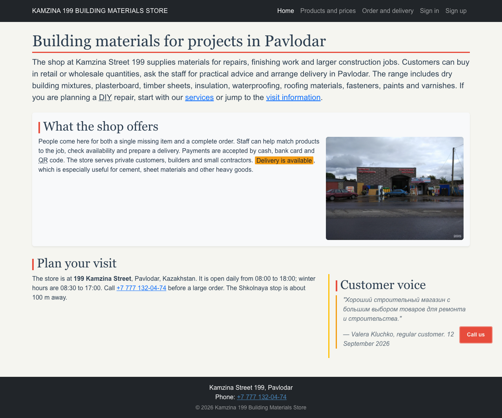
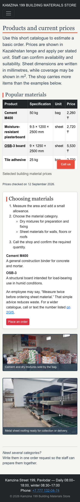
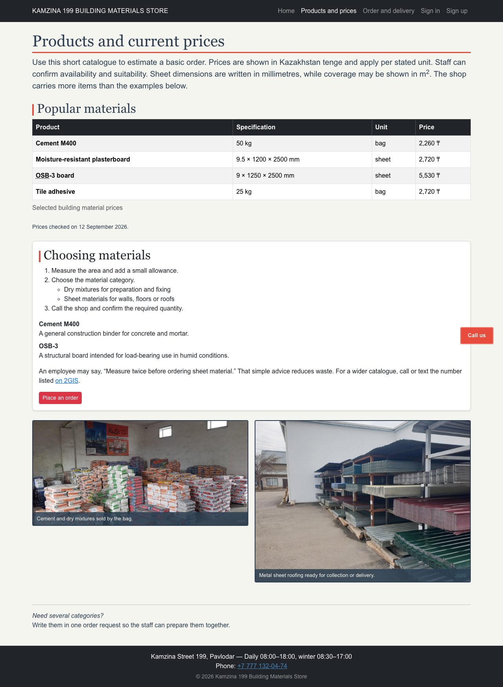
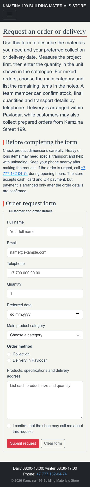
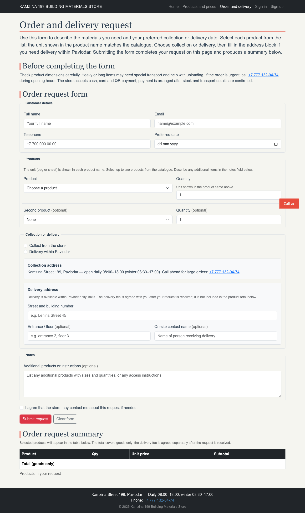
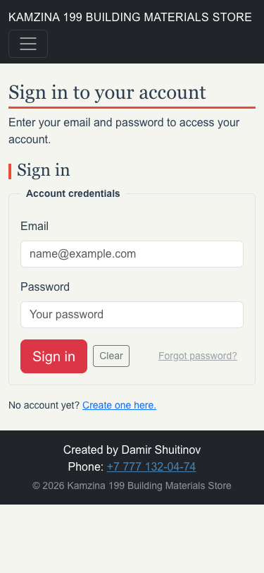
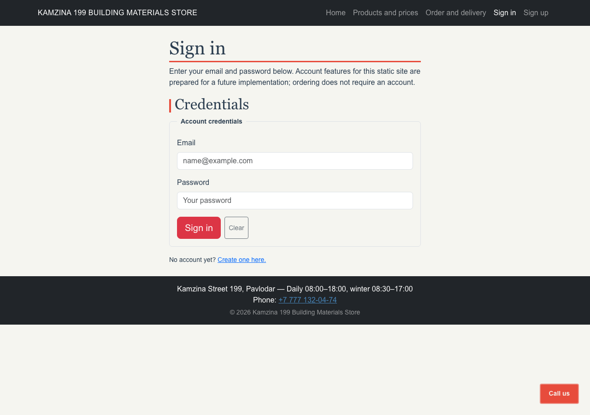
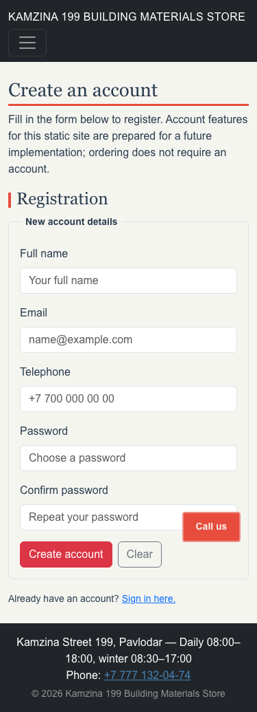
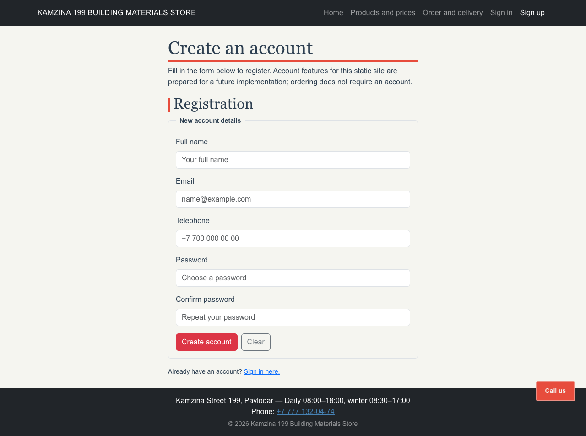

# Kamzina 199 Building Materials Store

Midterm project website for a real building materials store at 199 Kamzina Street, Pavlodar.
Built with Bootstrap 5.3.3 and a thin custom branding stylesheet.

**Bootstrap version:** 5.3.3 (CDN: jsDelivr)

## Open the site

Open `index.html` directly in a browser. Use the navigation menu to move between pages.
No build step or server is required.

## Pages

- `index.html` — home page: store overview, services, visit information
- `products.html` — six materials, search, category filtering and cart
- `order.html` — material quantities, cart totals, delivery fields and a live summary
- `signin.html` — sign-in form with field validation
- `signup.html` — registration form with field validation

## Functionality Plan

Responsible student: **Damir Shuitinov**, as recorded in the HTML author metadata.
The functions below are planned for the JavaScript work in Assignments 4 and 5.
Account validation, order estimates and submitted reviews are intended to run locally.

| Page | Visitor goal | Function | Result | Responsible student |
|---|---|---|---|---|
| `index.html` | Find the store and share an experience | Follow service/visit anchors, use telephone links, validate and add a review with a category and rating | Relevant section or telephone handler opens; a valid review appears with stars and a Pavlodar timestamp; invalid input gets field errors | Damir Shuitinov |
| `products.html` | Find materials and prepare a cart | Search by name/specification/category, filter/reset, add/increase/decrease/remove/clear items, continue to order | Matching materials and no-results feedback appear; quantities and totals update; the tab's cart transfers to the order page | Damir Shuitinov |
| `order.html` | Prepare a collection or delivery estimate | Validate material quantities and contact/date/confirmation fields, toggle delivery fields, update the summary, review or clear the form | A valid request gets a local reference and goods total; missing delivery addresses are rejected; duplicate reviews are blocked until something changes; clearing the form retains the cart | Damir Shuitinov |
| `signin.html` | Check sign-in details | Validate email and a nonblank password; clear the form | Errors identify invalid fields; valid input gets confirmation and the password is cleared; no login/session is created | Damir Shuitinov |
| `signup.html` | Check registration details | Validate name/email, optional phone, an eight-character password and exact confirmation; clear the form | Invalid fields receive correction hints; valid input gets confirmation and resets the form; no account is created | Damir Shuitinov |

## Submission constraints

- Keep the midterm tag unchanged once it has been established.
- Preserve the HTML interface elements; HTML source edits are limited to deferred JavaScript script links.
- Preserve all CSS rules; use existing Bootstrap classes and prepared CSS states for JavaScript interactions.

## Screenshots

### Home page

| Mobile (375 px) | Desktop (1280 px) |
|---|---|
|  |  |

### Products and prices

| Mobile (375 px) | Desktop (1280 px) |
|---|---|
|  |  |

### Order and delivery

| Mobile (375 px) | Desktop (1280 px) |
|---|---|
|  |  |

### Sign in / Sign up

| Sign in — mobile | Sign in — desktop | Sign up — mobile | Sign up — desktop |
|---|---|---|---|
|  |  |  |  |

## Three visitor journeys

### 1. Browse products and prepare an estimate

**Start:** Open `products.html` from the navigation.

1. Search materials or choose a category. Use Reset filters to show all six products.
2. Add materials to the cart. Increase, decrease or remove items as needed.
3. Click **Continue to order** and enter customer details and a preferred date.
4. Select collection, confirm the details and click **Review request**.

**End:** A reference and summary appear on the page, with instructions to contact the store.

---

### 2. Prepare a delivery estimate

**Start:** Open `order.html` directly or with a catalogue cart.

1. Choose a material and quantity, then click **Add to cart**.
2. Enter customer details and today or a future date.
3. Choose **Delivery within Pavlodar** and enter the required address.
4. Add any notes, confirm the details and click **Review request**.

**End:** The live summary shows the materials, contact details, delivery address and goods total.
Delivery costs are excluded. Correcting fields clears outdated validation errors.

---

### 3. Browse the store, check hours, and call directly

**Start:** Open `index.html`.  
**Steps:**  
1. Read the "What the shop offers" section.  
2. Follow the same-page link to **visit information** (the `#visit` anchor).  
3. Note the opening hours and address: Kamzina Street 199, daily 08:00–18:00.  
4. Click **Call us** or tap the telephone link.

**End:** The phone app opens with `+7 777 132-04-74` ready to dial.

---

## Repository structure

- `css/base.css` — midterm branding and prepared JavaScript states
- `js/main.js` — shared product data, calculations, cart rendering, messages and validation
- `js/products.js`, `js/order.js`, `js/signin.js`, `js/signup.js` — page-specific interactions
- `js/reviews.js` — review form and DOM-generated review cards
- `css/damir.css` — styles consolidated into base.css
- `images/` — store photographs
- `screenshots/` — responsive screenshots at 375 px, 768 px and desktop width
- `report/` — assignment reports
- `tag-checklist.md` — HTML tag evidence
- `css-checklist.md` — CSS technique evidence
- `css-removal-list.md` — Bootstrap migration map
- `ai-log.md` — AI assistance log
- `validation-results.txt` — W3C validation record (rerun after final edits)

## Assignments 4 and 5

Scripts use strict mode, `const` by default and `let` for changing state. The shared
product array has six objects with IDs, names, categories, specifications, units and prices.
`filterProducts` filters materials, `getCartLines` transforms cart data and
`getCartTotal` aggregates subtotals. Reusable functions call one another; the
request reference uses `Math.random()`. Page scripts use `addEventListener`.

Only cart IDs and quantities are kept in tab-scoped `sessionStorage`. Account forms
validate fields. The review form adds submitted reviews to the page with a name,
category, rating and timestamp. Catalogue entries include pack sizes, units and
estimated prices.

## Essential midterm corrections

These decisions are recorded before implementing the corrections. HTML source files
keep their original interface elements; deferred script links enable interactions. CSS
supplies shared branding and states. JavaScript reuses the existing catalogue table, two product
rows, form fields, error areas and order summary, adding only the assignment controls
with Bootstrap classes and the prepared `d-none`, `is-invalid` and `selected-row` states.

- The review script hides the static quotation aside and provides a review form.
- Catalogue prices are labelled as estimates, with instructions to confirm current
  prices and availability with the store.
- Scripts prevent the original GET submissions and enable accessible custom validation.
  Order details are presented in a summary with instructions to contact the store.
- Error elements receive IDs and ARIA associations through JavaScript. Missing feedback
  elements are generated using Bootstrap's existing validation classes.
- The original material selectors are populated from the shared six-product array.
  JavaScript adds quantity previews, Add to cart buttons and controls in the existing
  summary table. A product must be added before checking the request.
- Collection is the initial method. Scripts hide and disable delivery fields until
  delivery is selected, require its address only then, and ask customers to confirm their details.
